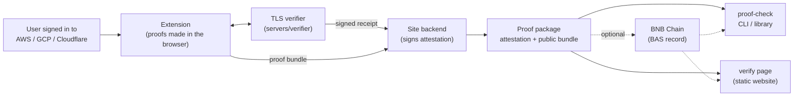
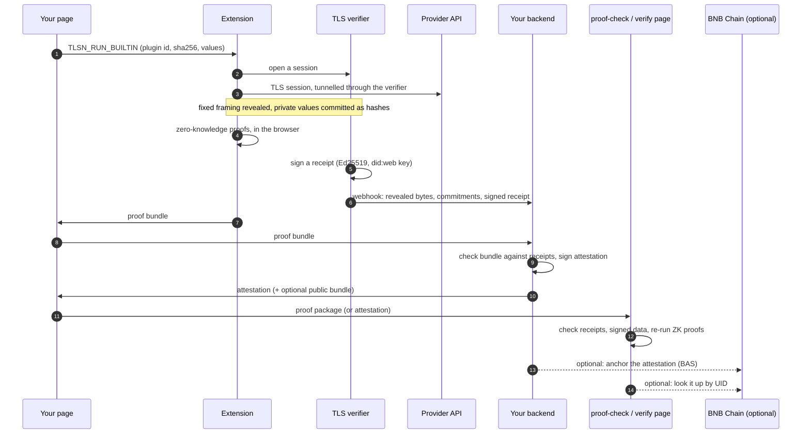
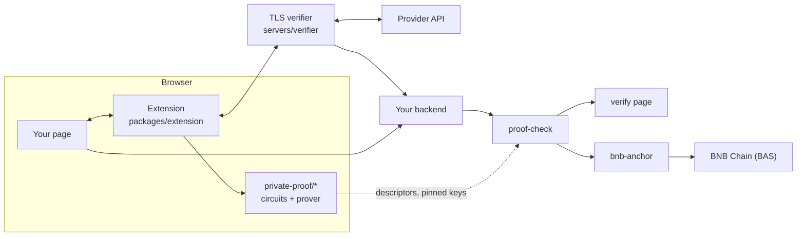

# 16signals-verify

Prove facts about an AWS, Google Cloud or Cloudflare account without sharing credentials or raw data. A person signs in
to the provider in their own browser. An extension collects evidence from that session and turns it into a small,
signed claim, for example "this user changed IAM roles and Lambda functions in the last 90 days". Anyone can re-check
the result offline. The proof can optionally be anchored on BNB Chain.

> [!NOTE]
> This is a fork of [tlsnotary/tlsn-extension](https://github.com/tlsnotary/tlsn-extension), based on release
> `0.1.0.1501` (commit `68bbd38`). Upstream history is kept unchanged; this fork's work is merged on top of it.
> Upstream's own README is kept in [docs/upstream.md](docs/upstream.md).
>
> Licensed like upstream: MIT or Apache-2.0, at your option ([`LICENSE-MIT`](LICENSE-MIT),
> [`LICENSE-APACHE`](LICENSE-APACHE)).

## The big picture

Two jobs, kept apart:

1. **Collect evidence.** The browser extension and a TLSNotary verifier server read activity from AWS, Google Cloud
   or Cloudflare without exposing credentials or private data. Zero-knowledge proofs are made in the browser. The
   result is a proof package: the verifier's signed receipts, the disclosed data, the commitments and the
   zero-knowledge proofs. A site can also issue a shorter signed attestation over the result.
2. **Verify evidence.** [`proof-check`](packages/proof-check) is the reusable engine. For a proof package it
   checks the verifier's receipt signatures, the server names, the signed data, re-runs the zero-knowledge proofs
   against the pinned keys and, if used, checks the blockchain record. For an attestation it checks the signature,
   the pinned keys and the claim. It runs as a command-line tool
   or a library (another app or script checks a proof), and it powers the [verify page](verify/) (a website where
   people upload and inspect a proof).

Optionally, BNB anchoring records a proof's hash on-chain, so people can check that a proof matches the published
record.



Collecting and verifying are separate jobs. Other projects can reuse the verification work without rebuilding the
proof system.

## What can another project reuse?

Packages are not on npm yet. They are used from this repository (npm workspaces); npm packages are planned. The
examples below import from the repository.

### Verify existing AWS, GCP and Cloudflare proofs

Plug in the provider descriptors and the pinned verification keys. There are no checks to rewrite.

```js
import { verifyCommitment, parseDropped, loadConfig } from './packages/proof-check/index.mjs';
const { providers, keys } = await loadConfig(new URL('./verify/verify.config.json', import.meta.url), { readJson });
const result = await verifyCommitment({ dropped: parseDropped(text), providers, keys });  // result.status, result.checks
```

`readJson(url)` reads JSON in your environment (`fetch` or `fs`). The same checks run from the command line:

```sh
node packages/proof-check/cli.mjs attestation.json [--bundle bundle.json]
```

Only attestations signed by a key in your `keys.json` are accepted, so you choose whom to trust.

### Build a different verification website

Use the same engine with your own design and language. Either mount the ready-made page into an element:

```js
import { mountVerify } from './verify/page.mjs';
await mountVerify(document.getElementById('verify'), './verify.config.json');
```

or call `verifyCommitment` yourself and render the `checks` array. Each check has a stable `id` (`signature`,
`provider`, `bundle`, `proof-hash`, `verification-keys`, `claim`), so you can show your own text per check. See
[verify/README.md](verify/README.md) and [packages/proof-check/README.md](packages/proof-check/README.md).

### Add new providers or checks

Write three small things and pass them in:

- a **descriptor** `{ id, kind, pins, claim, claimFromResult, describe }`: the evidence type, its pinned verification
  keys, how to recompute the claim from the public inputs, and the headline to show;
- a **registry** `{ findAttestations, findBundle }`, if attestations live somewhere other than a file (the BNB
  registry is one);
- **trusted keys**: the verifier public keys you accept.

Only `id` is required in a descriptor. Details and the exact shapes are in
[packages/proof-check/README.md](packages/proof-check/README.md); how a provider is organised is in
[private-proof/README.md](private-proof/README.md).

### Generate new proofs

This is a separate integration. You can reuse the extension flows, but you configure your own site origin and
verifier: copy [`fork/config.example.env`](fork/config.example.env) to `fork/config.env` and build the extension for
your site ([Plug it into your project](#plug-it-into-your-project)). Cloudflare proofs need your own OAuth client
(`FORK_CF_OAUTH_CLIENT_ID`). A genuinely new kind of proof (a new provider or a new claim) needs new circuits, a new
plugin and a new descriptor.

## Parts

| Part | Folder | What it does | How to use |
| --- | --- | --- | --- |
| Extension | [`packages/extension`](packages/extension), [`fork/`](fork) | Chrome extension that runs the built-in proving plugins and exposes `window.tlsn.runBuiltIn()` to your page | `cp fork/config.example.env fork/config.env`, `npm ci && npm run build:fork`, load `fork/out/extension` unpacked |
| Private proofs | [`private-proof/gcp`](private-proof/gcp), [`aws`](private-proof/aws), [`cloudflare`](private-proof/cloudflare) | Per provider: Noir circuits, the in-browser prover, the bundle verifier and the descriptor used by proof-check | [private-proof/README.md](private-proof/README.md) |
| TLS verifier | [`servers/verifier`](servers/verifier) | Rust server that observes the TLS session, checks commitments and signs a receipt per proof | Docker or `cargo run`; see [servers/verifier/README.md](servers/verifier/README.md) |
| proof-check | [`packages/proof-check`](packages/proof-check) | Re-checks proof packages (receipts, signed data, zero-knowledge proofs) and attestations (signature, pins, claim), plus optional on-chain records | `node packages/proof-check/cli.mjs --proof package.json` or `import` it |
| BNB anchoring | [`packages/bnb-anchor`](packages/bnb-anchor) | Writes a signed attestation to BNB Chain through BAS and reads it back | `node packages/bnb-anchor/cli.mjs register \| publish \| read` |
| Verify page | [`verify/`](verify) | Static page that checks a dropped file or a BNB attestation UID in the viewer's browser | Host the repository root; open `/verify/` |
| Core pins | [`core/`](core) | Pinned, patched TLSNotary core used by the WASM prover and the verifier | `bash core/prepare-core.sh "$PWD/core/tlsn"` before a native verifier build |

## Plug it into your project

A runnable version of these steps, from sign-in to a checked proof package: [examples/demo](examples/demo/README.md).

1. **Run a TLS verifier.** Build and run it with Docker (the build context is the repository root). The webhook
   file maps the provider host to your backend; `*` matches any host.

   ```sh
   docker build -f servers/verifier/Dockerfile -t tlsn-verifier-server .
   docker run -p 7047:7047 \
     -v "$PWD/my-config.yaml:/app/config.yaml" \
     -v "$PWD/attestor-key.json:/run/attestor-key.json:ro" \
     -e TLSN_ATTESTOR_KEY_FILE=/run/attestor-key.json \
     -e TLSN_ATTESTOR_KID='did:web:verifier.example.com#tlsn-attestor' \
     tlsn-verifier-server
   ```

   `my-config.yaml` holds `webhooks: { "*": { url: "https://your-backend.example.com/webhook" } }`. With an attestor
   key (an Ed25519 JWK) every webhook payload also carries a signed `receipt`; without one it carries none. Key
   format, the `did:web` setup and the limits (`TLSN_MAX_SESSIONS`, `TLSN_MEMORY_BUDGET_MB`, ...) are in
   [servers/verifier/README.md](servers/verifier/README.md). The built-in proxy is at `ws://<host>:7047/proxy`.

2. **Build the extension for your site.** Set `FORK_PRODUCT_ORIGINS` (your page's origin), `FORK_KEY_FILE`,
   `FORK_PLUGIN_DIR` and, for Cloudflare, `FORK_CF_OAUTH_CLIENT_ID` in `fork/config.env`, then
   `npm ci && npm run build:fork`. Load `fork/out/extension` unpacked. With an empty config you get a development
   build for pages on `http://localhost:5173` or `:5175`. See [Build for your site](docs/architecture.md#build-for-your-site).

3. **Request a proof from your page.** On an allowed origin, in the top frame:

   ```js
   window.postMessage({ type: 'TLSN_RUN_BUILTIN', payload: {
     pluginId: 'gcp-work',            // or 'aws-private-work', 'cloudflare-private-work'
     fingerprint,                     // sha256 of the packaged plugin, from window.tlsn.builtInPlugins
     verifierUrl, proxyUrl,           // your verifier and its proxy
     params: JSON.stringify(params),  // the plugin's parameters
     requestId,                       // your id; every reply carries it
     sessionData,                     // optional, string values
   } }, window.location.origin);
   ```

   `window.tlsn.runBuiltIn({...})` wraps this and returns the result or rejects with an error. Replies are window
   messages with your `requestId`: `TLSN_RUN_BUILTIN_ACK` (private runs), progress events, then
   `TLSN_RUN_BUILTIN_RESPONSE` with `{ success, result }` or `{ success: false, error }`. No ACK within 10 seconds
   means the extension is missing or was reloaded.

4. **Build the proof package in your backend.** Check the proof bundle against the verifier's receipts with the
   provider's `verify-bundle.mjs`, then build the package from the webhooks with `webhookRun` and `buildPackage`
   from `proof-check` (see [building a package](packages/proof-check/README.md#building-a-package)). To publish a
   signed attestation as well, use `fromVerifiedBundle`, `createAttestation` and `signAttestation`
   ([publishing side](packages/proof-check/README.md#publishing-side)).

5. **Check a proof.**

   ```sh
   node packages/proof-check/cli.mjs --proof package.json --did did.json   # did.json: your verifier's DID document
   node packages/proof-check/cli.mjs attestation.json --bundle bundle.json  # a signed attestation
   ```

   It prints one line per check. Exit code 0 means all checks passed, 1 a check failed, 2 bad input.

6. **Optional: anchor on BNB Chain.**

   ```sh
   cd packages/bnb-anchor && npm ci
   export BNB_PRIVATE_KEY=0x...        # funded account; BNB_NETWORK=bsc for mainnet (default: bsc-testnet)
   node cli.mjs register               # once per network
   node cli.mjs publish attestation.json
   node cli.mjs read 0x<uid>
   ```

7. **Optional: host the verify page.** Serve the repository root and open `/verify/`
   (`python3 -m http.server 8080`, then `http://localhost:8080/verify/`). Put your verifier's public key in
   `verify/keys.json`. See [verify/README.md](verify/README.md).

## Architecture

One proof, end to end:



The pieces and how they connect:



### How it works technically

- **TLSNotary.** The extension runs a TLS session with the provider through a TLSNotary verifier, so the verifier
  can vouch for what the provider sent without learning the private parts. These proofs use the verifier's Proxy
  mode: the verifier opens the connection to the provider and the browser tunnels its TLS session through it. The
  core is pinned and patched ([`core/`](core)).
- **Selective disclosure.** Fixed text such as HTTP framing is revealed. Each private value is hashed with a random
  blinder, `sha256(value || blinder)`, and only the hash goes to the verifier.
- **Private ranges as commitments.** For each hash-committed range, the verifier's signed receipt (v2) holds a commit
  leaf over the digest it checked for exactly that range. That ties the commitment a zero-knowledge proof later opens
  to the TLS session. See [Signed receipts](servers/verifier/README.md#signed-receipts).
- **Noir circuits and pinned keys.** Circuits prove, in the browser, that the committed values have the right
  structure and meet the policy (for example a log entry is inside the window). Their verification keys are pinned by
  hash in each provider's `generated/` folder, and the pins are checked by `proof-check`.
- **Proof packages.** A package holds, per TLS session, the verifier's signed receipt, the leaf layout, the disclosed
  bytes with their salts, the commitments and the zero-knowledge proofs. `proof-check` rebuilds the signed root from
  them, checks each server name against the provider's hosts, and re-runs the proofs with bb.js (browser or Node),
  requiring their commitment inputs to equal the signed commit leaves. See
  [packages/proof-check/README.md](packages/proof-check/README.md).
- **Attestations and the bundle commitment.** The backend signs an Ed25519 attestation over a commitment: the
  `sha256` of the canonical JSON of the provider, the claim, the proof hash (hash of the public bundle), and the
  key hashes. See [docs/architecture.md](docs/architecture.md#data-flow-of-a-cloud-private-proof).
- **BAS schema.** Anchoring writes one record per attestation to the BNB Attestation Service with the schema
  `bytes32 commitment,string provider,string claim,uint16 window,string attestation`. See
  [docs/bnb.md](docs/bnb.md).

## Security model

| Party | Sees | Signs or vouches for |
| --- | --- | --- |
| Provider | An ordinary session from the user's browser | Nothing |
| TLS verifier | The user's IP address, hosts contacted, timing, traffic sizes, the revealed framing and the blinded hashes. Never the private values or blinders | A receipt over the ranges it witnessed (Ed25519, `did:web` key) |
| Your backend | The claim, the proof bundle, the commitments | The attestation, after checking the bundle against the receipts |
| Anyone with the attestation | The coarse claim, the commitment, the signature, and the bundle if it is shared (proofs and public inputs: blinded hashes, lengths of hidden values, the time cutoff) | Nothing |

What a passed proof-package check means: a TLS verifier whose key you trust witnessed sessions with the provider's
hosts; the disclosed data and commitments are exactly what it signed; and the zero-knowledge proofs verify against
the pinned keys and open those signed commitments. The checker re-runs the proofs itself.

What a passed attestation check means: a key you trust signed exactly this claim, proof hash and pins; the published
bundle is the one that was signed; the bundle uses the verification keys pinned in this repository; and, where the
provider's descriptor can recompute the claim from the public inputs (GCP, AWS event runs), the claim matches them.

What it does not mean:

- **Trust in the verifier key.** A proof package rests on the TLS verifier's receipt key; an attestation rests on
  the key that signed it, which takes on trust that the proofs came from a real session and verify (attestation
  checks do not re-run the zero-knowledge verifier). Anyone can run their own verifier and publish its key; you decide
  which keys to trust.
- **Proxy mode.** The verifier sees the provider's TLS records directly. A transcript is only as authentic as the
  verifier that observed it.
- **Pins.** Verification keys are pinned in this repository. A descriptor without `pins` only checks that the keys
  cover the circuits used. A circuit bug is a bug in every proof made with it.
- **Claims are coarse and positive.** A skill group that is not in the claim was not established, which is not evidence
  of no activity. Claims say nothing about configuration correctness or outcomes.
- **Claims from data.** No provider rebuilds its readable claim from the disclosed bytes yet (`claimFromData`), so
  that check reads "not applicable". For Cloudflare the public inputs do not determine the skill groups either, so
  its claim rests on the signature.
- **GCP.** The name of the request header that carries the run's nonce is fixed by the circuit, so the proof only
  accepts a transcript with that header.
- **Compromised browsers.** The user's browser and machine are assumed not to be compromised.

More: [docs/architecture.md](docs/architecture.md#trust-model).

## What BNB Chain does here

A verified proof ends as a signed attestation: a small record saying which provider was checked, the coarse claim
that was proven, the time window, a commitment to the private values, the proof hash and the verifier's Ed25519
signature. By default it is a file the user keeps.

BNB Smart Chain makes that record public and durable without anyone hosting the file.
[`packages/bnb-anchor`](packages/bnb-anchor) writes the signed attestation into the BNB Attestation Service (BAS), the
attestation contract and schema registry that BNB Chain already runs. This repository deploys no contract of its own:
it registers one schema and writes one record per attestation. The [verify page](verify/) reads a record back by its
BAS UID and runs exactly the checks it runs on a file.

- **What goes on chain:** only the signed attestation. Never a proof, a transcript, or an identifier of the user or
  their account.
- **Who can anchor:** anyone holding an attestation. Trust comes from the signature inside the record, checked against
  [`verify/keys.json`](verify/keys.json), so anchoring a forged record gains nothing.
- **Networks:** BSC testnet by default (chain id 97); BSC mainnet (56) with `BNB_NETWORK=bsc`.

Details, schema and commands: [docs/bnb.md](docs/bnb.md).

## CROPS

Censorship resistance, open source, privacy and security. Each point with its code and limits is in
[docs/crops.md](docs/crops.md) and [docs/crops-compliance.md](docs/crops-compliance.md).

- **Censorship resistance.** Signed attestations and public bundles are plain files the user keeps. A signed
  attestation can also be anchored on BNB Smart Chain and read by its UID. [`verify/`](verify) is a static page
  anyone can host, and anyone can run their own verifier from this repository.
- **Open source.** MIT or Apache-2.0. Everything builds from this repository. `proof-check`, `bnb-anchor` and `verify/`
  are plain ES modules with no build step.
- **Privacy.** The provider sees an ordinary session. The verifier sees network metadata and blinded hashes, never the
  private values. The verify page is static; a lookup by BNB Chain UID reads one record from a public RPC, which sees
  the viewer's IP address and the UID.
- **Security.** Attestations are Ed25519 signatures over a canonical commitment. Signing keys live only in the signer's
  environment; public keys are listed in [`verify/keys.json`](verify/keys.json).

## Documentation

- [Architecture](docs/architecture.md): components, data flow of a private proof, trust model, build
- [Verification](docs/verification.md): the verify page, checks, verifier keys, hosting
- [BNB Chain anchoring](docs/bnb.md): publishing attestations to BAS and looking them up
- [CROPS](docs/crops.md) and [CROPS compliance](docs/crops-compliance.md): each guarantee, the code that enforces it, its limits
- Parts: [proof-check](packages/proof-check/README.md), [bnb-anchor](packages/bnb-anchor/README.md),
  [verify page](verify/README.md), [private proofs](private-proof/README.md) ([GCP](private-proof/gcp/README.md),
  [AWS](private-proof/aws/README.md), [Cloudflare](private-proof/cloudflare/README.md)),
  [TLS verifier](servers/verifier/README.md)
- [Upstream README](docs/upstream.md): the original tlsn-extension documentation
