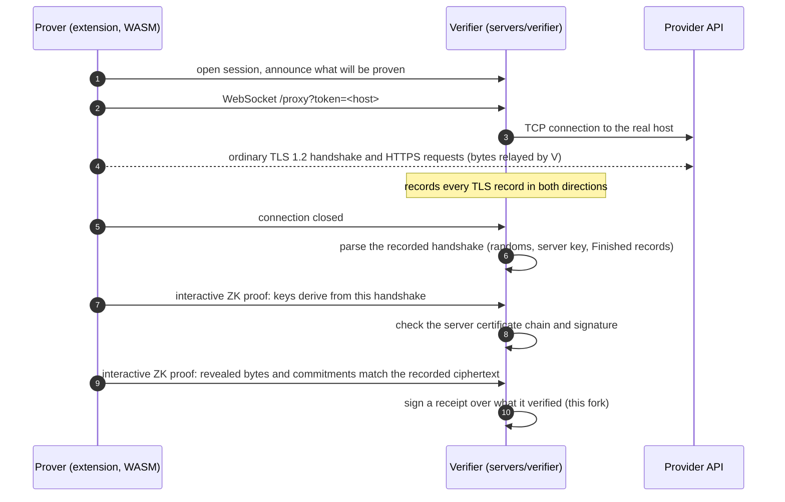
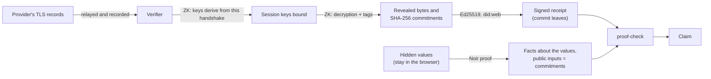

# How it works

This page explains, from the bottom up, how a proof is made and why a stranger can trust it: the zkTLS layer
(TLSNotary in Proxy mode), the zero-knowledge layer on top of it (Noir circuits), and how `proof-check` ties the two
together. Code references point to the pinned TLSNotary core (`v0.1.0-alpha.15`, see [`core/VERSION`](../core/VERSION))
and to this repository.

## The problem zkTLS solves

When your browser loads `https://iam.amazonaws.com/...`, TLS convinces *you* that the bytes came from AWS. It cannot
convince anyone else. TLS encrypts and authenticates application data with symmetric session keys that the client
holds, so a client can produce a "transcript" for any content it likes, and the server never signs the data itself.

zkTLS adds a third party that took part in, or watched, the session and can later vouch for parts of it, without
learning the session keys or the private parts of the data. In TLSNotary terms:

| Role | Here | Runs |
| --- | --- | --- |
| Prover | The browser extension (Rust core compiled to WASM) | The real TLS client; holds the session keys |
| Verifier | [`servers/verifier`](../servers/verifier) (the same Rust core, native) | Watches the session, checks the prover's proofs, signs a receipt |
| Server | AWS, Google Cloud or Cloudflare | An ordinary HTTPS API; it is not modified and learns nothing |

TLSNotary has two ways for the verifier to take part. In **MPC-TLS** the verifier and prover jointly hold the session
keys through two-party computation, so neither can act alone. In **Proxy mode**, which every proof in this repository
uses, the verifier relays the connection and records the encrypted traffic, and the prover keeps the keys. Proxy mode
is much cheaper (no garbled-circuit TLS handshake) and still lets the prover reveal or hide whatever it wants.

## A Proxy-mode session, step by step

1. **Relay and record.** The extension opens a WebSocket to the verifier's built-in proxy
   (`WS /proxy?token=<host>`), and the verifier opens the TCP connection to the provider. Every TLS record in both
   directions passes through the verifier, which keeps a copy (a recording reader in the core's `proxy.rs`). Because
   the verifier opened the connection to the real host, it knows the ciphertext really came from that server's side of
   the connection, and the prover cannot substitute other bytes.
2. **Ordinary TLS.** The extension runs a normal TLS 1.2 handshake and its HTTPS requests over that tunnel. Only the
   prover knows the master secret; the verifier sees ciphertext. (The core's Proxy mode supports the TLS 1.2
   certificate binding only.)
3. **Prove the keys belong to this session.** After the connection closes, the verifier parses the recorded
   transcript: the client and server randoms, the server's ephemeral key, and the encrypted `Finished` messages. The
   two sides then run an interactive zero-knowledge proof in mpz's ZK virtual machine (a VOLE-style proof built on
   Ferret correlated oblivious transfer). The master secret is a private input that only the prover knows. Inside the
   proof, the TLS 1.2 PRF derives the client and server write keys and IVs and both `Finished` verify-data values from
   the recorded randoms and handshake hashes, and the circuit checks that encrypting the verify-data gives exactly the
   recorded `Finished` ciphertexts. If it passes, the keys the prover uses from now on are provably this session's
   keys, and the verifier still never learns them (`proxy/verifier.rs`, `finalize`).
4. **Prove who the server was.** The verifier checks the server's certificate chain against its root store at the
   connection time, checks the server's signature over its ephemeral key from the handshake, and checks the server
   name (`verifier/verify.rs`). That ties the session to, say, `cloudtrail.us-east-1.amazonaws.com`.
5. **Reveal and commit.** For each range of the request or response the prover chooses either to reveal it or to
   commit to it. In the same ZK machine it proves that the plaintext is the AES-GCM decryption, under the proven keys,
   of the recorded ciphertext, and that the records' authentication tags are valid (`transcript_internal/commit.rs`,
   `tag.rs`).
   - A **revealed** range: the verifier learns the plaintext (here: HTTP framing and other fixed text).
   - A **committed** range: `SHA-256(plaintext ‖ blinder)` is computed inside the proof with a random blinder, and the
     verifier learns only the digest. It learns nothing about the value except its length.

   The cost grows with the number of AES blocks a proof authenticates, which is why the verifier caps it
   (`TLSN_MAX_REVEAL_BLOCKS`).
6. **Sign a receipt.** Upstream TLSNotary stops at "the verifier is convinced". This fork's verifier also signs what it
   verified, so that people who were not there can check it later. Each receipt is an Ed25519 JWS over a salted Merkle
   root of the session's ranges: revealed ranges by their bytes, and each committed range by a commit leaf
   `SHA-256(0x02 ‖ direction ‖ start ‖ length ‖ salt ‖ digest)` over the digest it checked for exactly that range
   (receipt v2). The public key is published at `/.well-known/did.json` (did:web). See
   [Signed receipts](../servers/verifier/README.md#signed-receipts).

The fork's other verifier changes (hash-only results, several proofs on one TLS session, memory admission and caps)
are listed in [architecture.md](architecture.md#verifier-server-role-proxy-mode). The core is pinned and patched in
[`core/`](../core).

## The second layer: proving things about hidden values

After step 5 the private values are only hashes. A hash alone proves nothing useful ("some log entry exists"). The
claim needs facts about the hidden values: this entry is a CloudTrail event, its time is inside the 90-day window, its
operation belongs to a given skill group.

That is the job of the [Noir](https://noir-lang.org) circuits in [`private-proof/<provider>`](../private-proof), proven
in the browser with Barretenberg (UltraHonk):

- **Private inputs:** the hidden plaintext and its blinder, which never leave the browser.
- **Public inputs:** the same `SHA-256(plaintext ‖ blinder)` commitments the verifier saw, plus policy values such as
  the time cutoff.
- **What a circuit proves:** that the private values hash to those commitments and have the required structure and
  properties (for example a valid log row, inside the window, of a certain kind).

The circuits' verification keys are pinned by hash in each provider's `generated/` folder, so a checker knows which
circuit a proof is for.

## Joining the two layers: what proof-check does

A proof package carries, per TLS session, the signed receipt, the leaf layout, the revealed bytes with their salts, the
commitments and the zero-knowledge proofs. [`proof-check`](../packages/proof-check) checks:

1. **receipt-signature:** each receipt is signed by a verifier key you trust (did:web document or `keys.json`).
2. **server-name:** each receipt names a host of the provider.
3. **signed-root:** the revealed bytes and the commitments rebuild exactly the Merkle root the verifier signed.
4. **zk-proofs:** each Noir proof verifies under the pinned key (bb.js, in Node or the browser), and its commitment
   public inputs equal the signed commit leaves, so a proof cannot be about values from some other session.
5. **claim-from-data:** the claim is rebuilt from the proofs' public inputs (Google Cloud) or is signed by an issuer key
   you trust (AWS, Cloudflare).
6. **on-chain** (optional): the package hash is in a BNB Chain record signed by a key you trust.

The chain of trust, end to end:

## What you have to trust

- **The verifier observed honestly.** In Proxy mode the verifier is the witness: its receipt says "these encrypted
  records came from this host". A dishonest verifier could sign anything, which is why trust is anchored on its
  published key, and why anyone can run their own verifier from this repository. In MPC-TLS the verifier co-holds the
  keys; in Proxy mode it does not, but it still cannot learn the private values or blinders.
- **The network path to the provider.** The verifier connects to the provider by host name, and the certificate check
  in step 4 makes the server's identity part of the proof.
- **The circuits.** They are open source and pinned by hash; a circuit bug affects every proof made with it.
- **The user's machine.** The browser and the machine are assumed not to be compromised.

The full threat model and what each party sees: [README, Security model](../README.md#security-model) and
[architecture.md, Trust model](architecture.md#trust-model).
