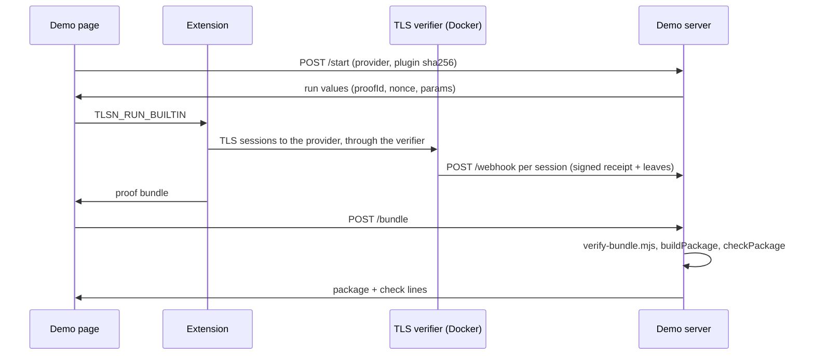

# End-to-end demo

A minimal site that runs a real private proof (Google Cloud, AWS or Cloudflare) from your own browser session and
turns it into a [proof package](../../packages/proof-check/README.md#proof-packages) anyone can re-check.



| File | Purpose |
| --- | --- |
| `server.mjs` | Node HTTP server, no dependencies: the page, `/start`, `/webhook`, `/bundle`, `/did.json`, and the repository's `verify/` page |
| `providers.mjs` | Per provider: the built-in plugin and its params, the attempt fields its bundle verifier checks, its pinned proof runtime |
| `index.html` | The page: finds the extension, starts the run, shows progress, offers the package |
| `config.example.yaml` | The verifier's webhook config, pointing at the demo server |
| `make-attestor-key.mjs` | Writes an Ed25519 attestor key (JWK, mode 600) for the verifier's signed receipts |

State is in memory and nothing is authenticated: run it on your own machine only.

## What you need

- Linux x64, Node 22+, Docker and Chrome.
- The extension build toolchain: `nargo` 1.0.0-beta.19, Rust `nightly-2026-05-21` with `wasm32-unknown-unknown`, and
  clang 15.0.7 (see [Build for your site](../../docs/architecture.md#build-for-your-site)).
- Nothing else for AWS and Cloudflare: the extension build bundles their plugins from source
  (`private-proof/{aws,cloudflare}/plugin.ts`). The Google Cloud plugin (`gcp-work`) is not in this repository; to
  run Google Cloud, build your own `gcp-work.js` and pass a directory with all the bundles you want as
  `FORK_PLUGIN_DIR` (it replaces the default set).
- For Cloudflare: a Cloudflare OAuth client (Authorization Code + PKCE, no secret) whose redirect URI is
  `https://<extension id>.chromiumapp.org/`.
- An account to prove: a Google Cloud project you can open in Logs Explorer, an AWS IAM user that can sign in to the
  console and read CloudTrail, or a Cloudflare user.

## Run it

All commands run from the repository root. Ports: the demo on 18474, the verifier on 17047.

1. **Attestor key.** The verifier signs a receipt for every session with it.

   ```sh
   node examples/demo/make-attestor-key.mjs attestor-key.json
   ```

   It prints only the public key (`x`). Keep `attestor-key.json` out of version control.

2. **TLS verifier.** Build it, then run it with the key and the demo's webhook config.

   ```sh
   docker build -f servers/verifier/Dockerfile -t tlsn-verifier-server .
   docker run --rm -p 17047:7047 --add-host=host.docker.internal:host-gateway \
     -v "$PWD/examples/demo/config.example.yaml:/app/config.yaml:ro" \
     -v "$PWD/attestor-key.json:/run/attestor-key.json:ro" \
     -e TLSN_ATTESTOR_KEY_FILE=/run/attestor-key.json \
     -e TLSN_ATTESTOR_KID='did:web:localhost%3A17047#tlsn-attestor' \
     tlsn-verifier-server
   ```

   Check it from another terminal: `curl -s http://localhost:17047/.well-known/did.json` prints a DID document with
   your public key.

3. **Extension.** A development build whose page API is open to the demo's origin. It builds the AWS and Cloudflare
   plugins into `fork/out/plugins` and packages them:

   ```sh
   npm ci
   FORK_PRODUCT_ORIGINS=http://localhost:18474 npm run build:fork
   ```

   For Cloudflare add `FORK_CF_OAUTH_CLIENT_ID=<your client id>`; for Google Cloud, `FORK_PLUGIN_DIR` (see above).
   The build also compiles the circuits and keys into `private-proof/*/dist`, which the demo server uses to verify
   the bundle.

4. **Load it.** Open `chrome://extensions`, turn on Developer mode, click **Load unpacked** and pick
   `fork/out/extension`. For Cloudflare, register `https://<the id shown on the card>.chromiumapp.org/` as your OAuth
   client's redirect URI.

5. **Demo server.**

   ```sh
   DEMO_HOST=0.0.0.0 node examples/demo/server.mjs
   ```

   `DEMO_HOST=0.0.0.0` lets the verifier container reach `/webhook`. Optional: `DEMO_PORT` (default 18474),
   `VERIFIER_URL` (default `http://localhost:17047`), `DID_FILE` (the verifier's DID document from a file instead of
   `VERIFIER_URL`). To have the server re-run the zero-knowledge proofs too, install the optional verifier library
   once: `cd packages/proof-check && npm ci`.

6. **Prove.** Open `http://localhost:18474/`. Section 1 lists the extension's built-in plugins. Pick a provider
   (Google Cloud: also enter the project id and a window), click **Prove**, and sign in in the window the extension
   opens; keep that window open. The progress box shows the extension's acknowledgement, the plugin's steps, one line
   per verifier webhook ("signed receipt"), and the prover's progress. The proofs are made in the browser, which takes
   a few minutes.

7. **Check.** When the run ends, section 4 shows the package's check lines (`receipt-signature`, `server-name` and
   `signed-root` must be `ok`). Click **Download package**, then either open the verify page (the link; drop the file
   there) or run the command the page prints:

   ```sh
   curl -s http://localhost:18474/did.json > did.json
   node packages/proof-check/cli.mjs --proof gcp-package.json --did did.json --claim '<the claim shown>'
   ```

   Without `@aztec/bb.js` installed, `zk-proofs` is not run (`--`) and the result is `partial`; the verify page always
   re-runs the proofs in the browser.

## What each plugin needs from the page

The page posts `TLSN_RUN_BUILTIN` with `pluginId`, `fingerprint` (the plugin's sha256 from
`window.tlsn.builtInPlugins`), `verifierUrl` (`http://localhost:17047`), `proxyUrl` (`ws://localhost:17047/proxy?token=`;
the plugin appends the provider host), `methodUrls: { <METHOD>: { verifierUrl, proxyUrl } }` (the plugins only have
per-method URL slots), `requestId` = `proofId`, `sessionData: { proofId, method, mode: 'Proxy' }` and `params` (JSON
text):

| Plugin | Method | `params` |
| --- | --- | --- |
| `gcp-work` | `GCP_WORK` | `{ windowDays: 7 \| 30 \| 90, cutoff: <ms>, catalogDigest, proofId, nonceMac, privateInput: { projectId } }` |
| `aws-private-work` | `AWS_ACCOUNT` | `{ privateAttempt: { proofId, pluginSha256, nonceMac, identityService: 'iam', region: 'us-east-1', issuedAt, expiresAt } }` |
| `cloudflare-private-work` | `CLOUDFLARE_ACCOUNT` | `{ privateAttempt: { proofId, pluginSha256, nonceMac, issuedAt, expiresAt } }` |

`nonceMac` is 32 random bytes, base64url (43 characters); `expiresAt` is `issuedAt` + 15 minutes. The server keeps
these per attempt and checks every session against them (`expected` in each provider's `verify-bundle.mjs`). The
verifier posts one webhook per session; `session.id` names it (the bundle lists them in `sessionIds`) and
`session.proofId` ties it to the attempt.

## Tests

```sh
node --test --test-concurrency=1 examples/demo/server.test.mjs
```

It posts synthetic Cloudflare sessions (the provider's test fixtures) as signed webhooks, then the bundle, and checks
the package that comes back. No browser, Docker or network.
